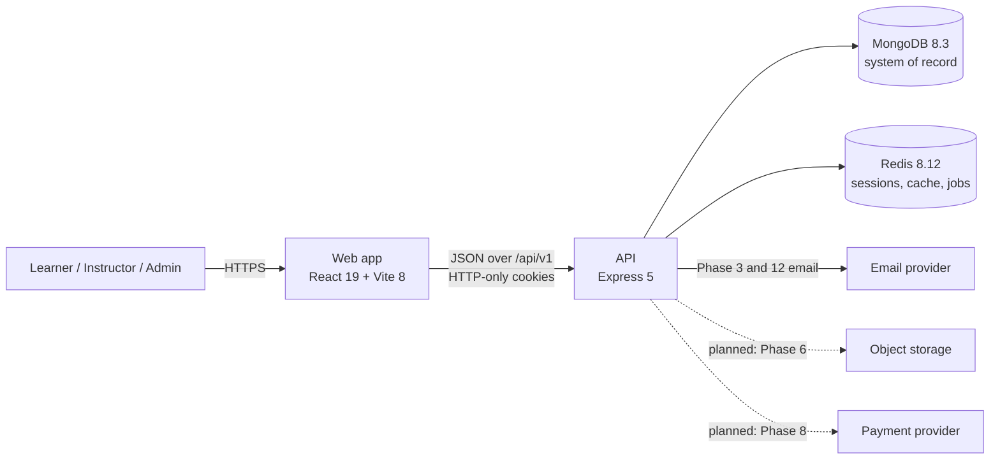
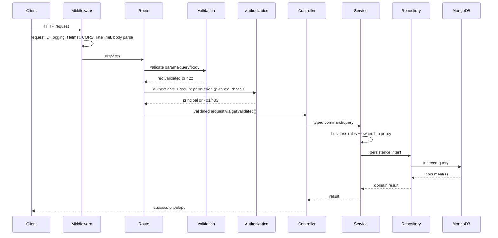
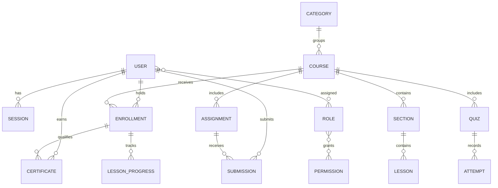
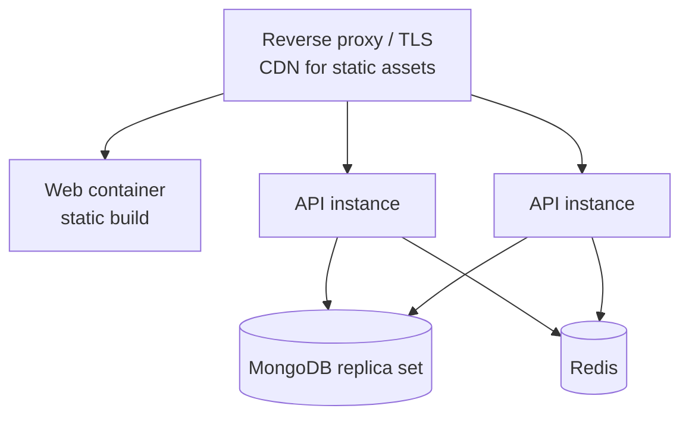

# Atrium LMS — Architecture

| Field    | Value                                            |
| -------- | ------------------------------------------------ |
| Status   | Phase 13 baseline — accepted                     |
| Updated  | 25 November 2026                                 |
| Scope    | Repository, applications, persistence, contracts |
| Audience | Maintainers, reviewers, AI agents                |

This document describes the architecture that the repository enforces today and the intended shape of later phases. Where something is planned rather than implemented, it is labelled **planned**.

---

## 1. Design goals and constraints

Atrium is a learning management system delivered in 15 phases. The architecture is optimized for:

1. **Security by default.** Authorization is enforced on the server, input is validated at every boundary, and secrets never reach the client.
2. **Independent deployability.** `frontend/` and `backend/` can be built, tested, and deployed separately. The HTTP API is the only contract between them.
3. **Bounded complexity.** A modular monolith with explicit module boundaries, not a distributed system where a single team must operate service meshes and network failure modes.
4. **Testability.** Business rules live in services that can be tested without Express; persistence lives in repositories that can be replaced with fakes.
5. **Upgrade discipline.** Versions are pinned exactly and verified before adoption. Architectural changes require an ADR.
6. **Honest delivery.** No placeholder endpoints or UI that implies unimplemented capability.

Phase 2 establishes the persistence and cache foundation, schema conventions, request validation, and the generated API contract. Authentication, domain models, payments, uploads, real-time notifications, and production deployment remain out of scope until the phases defined in [`../PLAN.md`](../PLAN.md).

---

## 2. System context

Atrium is a two-application system backed by MongoDB and Redis, with external providers added only when a phase needs them.



**Trust boundaries**

- The browser is untrusted. Every role, ownership claim, price, timestamp, and identifier is re-derived or re-validated on the server.
- The API is the policy enforcement point. The SPA hides controls for usability only.
- MongoDB and Redis are internal services. They are never exposed directly to clients and never hold unhashed credentials or tokens.

**Today:** the web app renders a public status page; the API exposes `GET /health`, `GET /health/ready`, `GET /api/v1`, and non-production Swagger UI at `/api-docs`; MongoDB and Redis are connected with startup retries, readiness probes, and graceful shutdown.

---

## 3. Repository boundaries

```text
lms-mern-v1/
├── frontend/   @atrium/frontend — React SPA
├── backend/    @atrium/backend  — Express API
├── docs/       architecture, ADRs, source brief
├── PLAN.md     phase roadmap and acceptance criteria
└── docker-compose.yml  local infrastructure only
```

Rules:

- No cross-imports between workspaces. The frontend must not import backend source, and the backend must not import frontend source.
- Shared types are expressed as API contracts (OpenAPI 3.1, generated in Phase 2) and duplicated deliberately on the client as narrow view models, not by creating a third shared package prematurely.
- Each workspace owns its `package.json`, `tsconfig`, lint config, tests, and build. Root tooling is for orchestration only.
- Root scripts fan out with `--workspaces`; CI builds and tests both apps independently.

---

## 4. Backend architecture

### 4.1 Layered modular monolith

The API is a single deployable organized by feature module. Inside each module, dependencies point inward:

```text
route → controller → service → repository → model
```

| Layer      | Responsibility                                                | May depend on                                        |
| ---------- | ------------------------------------------------------------- | ---------------------------------------------------- |
| Route      | Path, method, middleware chain, wiring                        | controller, middleware, validators                   |
| Controller | HTTP translation: read validated input, call service, respond | service, shared HTTP helpers                         |
| Service    | Business rules, authorization decisions, orchestration        | repository interfaces, domain errors, other services |
| Repository | Persistence queries and mapping                               | Mongoose models                                      |
| Model      | Schema, indexes, hooks, invariants at the storage edge        | Mongoose, shared schema helpers                      |

**Hard rules**

- Controllers do not touch Mongoose models or build queries.
- Services do not accept `Request`/`Response` objects. They receive plain typed input and return plain typed results.
- Repositories do not throw HTTP errors. They return data or domain-specific failures.
- A module does not import another module's model or repository. Cross-module work goes through the other module's service.
- Routes and controllers stay thin. A controller with business branching is a design defect.

### 4.2 Module anatomy (target)

```text
backend/src/
├── app.ts                     Express composition, no listening
├── server.ts                  Process lifecycle, listening, signals
├── config/                    Validated environment, logger
├── middlewares/               Cross-cutting HTTP middleware, request validation
├── routes/                    Versioned API root
├── shared/                    Errors, HTTP envelope, async, query helpers, shutdown
├── infrastructure/            Mongo/Redis connections, readiness, schema plugins
├── docs/                      Zod-first OpenAPI generation and Swagger UI
├── seeds/                     Seed runner, registry, CLI
├── modules/
│   ├── health/
│   │   ├── health.routes.ts
│   │   └── health.controller.ts
│   └── <feature>/             planned pattern
│       ├── <feature>.model.ts
│       ├── <feature>.repository.ts
│       ├── <feature>.service.ts
│       ├── <feature>.controller.ts
│       ├── <feature>.routes.ts
│       ├── <feature>.validation.ts
│       └── <feature>.types.ts
└── types/                     Express augmentation
```

A module is created only when its phase begins. Empty scaffolding is not added ahead of need.

### 4.3 Request lifecycle



Express 5 forwards rejected promises from async handlers to the error middleware natively. No `asyncHandler` wrapper is used.

### 4.4 HTTP contract

All JSON responses share one envelope.

Success:

```json
{
  "success": true,
  "message": "Human-readable outcome",
  "data": {},
  "meta": {}
}
```

Error:

```json
{
  "success": false,
  "message": "Human-readable outcome",
  "code": "MACHINE_READABLE_CODE",
  "errors": [{ "field": "email", "message": "Invalid email", "code": "invalid_format" }],
  "requestId": "uuid"
}
```

- `meta` is present only when pagination or supplementary context exists.
- `errors` is present only for validation or field-level failures.
- Error messages are safe to show to users and never contain stack traces, queries, or secrets.
- `x-request-id` is always returned. Clients may supply one matching `[A-Za-z0-9._-]{8,64}`; otherwise a UUID is generated.
- Operational endpoints keep their own names: `/health` is unversioned; business endpoints live under `/api/v1`.

Error classes extend `AppError` and carry `statusCode`, stable `code`, and optional `details`. Unknown errors are normalized to `500 INTERNAL_SERVER_ERROR` without leaking internals. `ZodError` maps to `422 VALIDATION_ERROR`.

### 4.5 Startup and configuration

- Environment variables are parsed and validated by Zod at process start. The process fails loudly with field-level details if configuration is invalid.
- `app.ts` builds the Express application; `server.ts` owns dependency connection, listening, signal handling, and process exit. This split keeps Supertest integration tests free of ports and infrastructure.
- Startup connects MongoDB and Redis before listening. Failures are retried, then reported as a dependency-specific fatal error and exit code `1`.
- Graceful shutdown stops accepting connections, closes idle connections, waits for in-flight requests, disconnects Redis and MongoDB, and force-exits after 10 seconds.
- `/health` is liveness-only. `/health/ready` checks MongoDB and Redis with a bounded timeout and returns `503` when either is unavailable.
- `trust proxy` is explicit (`TRUST_PROXY_HOPS`, default `0`). Rate limiting and client IPs are not guesses.

### 4.6 Observability

- Pino structured logs with service, environment, and version fields.
- `pino-http` logs one line per request, with level derived from status code.
- Redaction covers authorization headers, cookies, passwords, and tokens.
- Request IDs correlate client reports, logs, and error bodies.
- `/health` is excluded from access logs to avoid noise.

Metrics, tracing, and log shipping are deployment-phase work (Phase 14/15), not part of this foundation.

---

## 5. Frontend architecture

### 5.1 Composition

```text
main.tsx
└── StrictMode
    └── App
        └── AppProviders (TanStack Query)
            └── RouterProvider
                └── PublicLayout (header, skip link, main, footer)
                    ├── HomePage
                    └── NotFoundPage
```

- `app/` contains composition only: providers, router, root component.
- `features/` contains vertical slices. A feature owns its components, hooks, API calls, and tests.
- `components/ui/` contains owned design-system primitives; `components/common/` contains shared product components; `components/layouts/` contains shells.
- `routes/` holds route-level pages that no feature owns (404, and later auth screens if not owned by a feature).
- `lib/` holds environment validation, the query client, and utilities.

### 5.2 State ownership

| State kind               | Owner                             | Examples                           |
| ------------------------ | --------------------------------- | ---------------------------------- |
| Server state             | TanStack Query (planned Phase 4)  | courses, enrollments, profile      |
| URL state                | React Router                      | filters, pagination, active tab    |
| Form state               | React Hook Form (planned Phase 4) | login, course editor, quiz answers |
| Ephemeral UI state       | local component state             | open menus, hover, expanded rows   |
| Client-only global state | Zustand (planned Phase 4)         | sidebar collapsed, theme shell     |

Rules:

- Never copy server data into a global store. Query cache is the server-state source of truth.
- Never store access tokens in `localStorage` or `sessionStorage`. See [ADR-0002](adr/0002-authentication-token-strategy.md).
- Derived values are computed, not synchronized with effects.

### 5.3 Styling and accessibility

- Tailwind CSS 4 with CSS-first semantic tokens in `src/styles/globals.css`. Components use semantic classes (`bg-background`, `text-muted-foreground`, `border-border`), not raw hex values.
- Brand palette: deep green and ink neutrals with a warm amber accent. Light theme is the default; dark tokens exist for Phase 4.
- Typography: Instrument Sans for display, Inter for body, loaded locally through Fontsource.
- Radix-based primitives (via shadcn ownership model) provide keyboard and screen-reader behavior. The foundation currently ships Button, Badge, and Card; the full library arrives in Phase 4.
- Every page has one `h1`, a skip link, visible focus states, and motion that respects `prefers-reduced-motion`.
- Color contrast is checked when new tokens or states are introduced (WCAG AA target).

### 5.4 Data access (planned Phase 4)

- A single Axios instance with `withCredentials: true`, normalized errors, and no token persistence.
- A query-key factory prevents ad-hoc key strings.
- Route-level code splitting and error boundaries keep the initial bundle bounded.
- Route guards render a neutral pending state until auth resolves, then fail closed.

---

## 6. Planned domain map

The following entities are introduced in the phase noted. This is a direction, not a schema commitment; exact fields are decided with the phase's requirements.



Phase placement:

| Domain                     | Phase | Notes                                              |
| -------------------------- | ----- | -------------------------------------------------- |
| User, Role, Permission     | 3     | Identity, RBAC seeds, audit logs                   |
| Session / RefreshToken     | 3     | Rotation, reuse detection, revocation              |
| Category, Course, Section  | 6     | Publishing state machine, approval, pricing        |
| Lesson, progress           | 7     | Video/text/PDF, protected asset access, ordering   |
| Enrollment                 | 8     | Unique user+course index, expiry, access policy    |
| Assignment, Submission     | 9     | Deadlines, versions, grading                       |
| Quiz, Question, Attempt    | 10    | Server-authoritative timers, deterministic grading |
| Certificate                | 11    | Non-enumerable IDs, verification, PDF              |
| Notification, Announcement | 12    | Preferences, email delivery state, job fan-out     |
| Analytics read models      | 12    | Role-scoped, bounded aggregations                  |

---

## 7. Data architecture

### 7.1 MongoDB as system of record

- One pooled connection per process, with startup retries and lifecycle logging.
- Models are created through `createBaseSchema()`, which applies timestamps at construction and normalizes JSON to expose `id` without `_id` or `__v`.
- Schema-level invariants: required fields, enums, immutable identifiers, timestamps.
- Compound indexes are designed from actual query shapes. Every list endpoint is paginated with a maximum page size of 100.
- Uniqueness is enforced by database indexes, not check-then-write logic. Duplicate enrollment under concurrency is a Phase 8 acceptance criterion.
- Multi-document invariants use transactions where MongoDB supports them; otherwise the design avoids the need.
- Soft delete is a deliberate per-entity decision, not a blanket plugin. Deleted records remain visible to explicit administrative queries; active-record queries must add `NOT_DELETED_FILTER`.
- Large binaries are never stored in documents. Phase 6 introduces a storage abstraction.

Detailed connection, schema, repository, and query rules: [`DATABASE.md`](DATABASE.md).

### 7.2 Redis responsibilities

Redis is not a second database. The client is connected with bounded startup and persistent runtime reconnects. It holds operational job state for the Phase 12 worker; no application cache keys exist yet. It is allowed for:

- Session and refresh-token metadata where revocation speed matters (Phase 3).
- Rate-limit and throttling counters across instances (Phase 3/13).
- Short-lived cache with explicit invalidation and a stated stale tolerance (later phases).
- Background job queues and scheduled reminders (Phase 12, implemented by ADR-0005).

Every cache must answer: what is the key, what is the TTL, what invalidates it, and what happens on a miss or Redis outage. Unbounded or unjustified caching is rejected in review.

### 7.3 Consistency boundaries

- Enrollment, grading, and certificate issuance are the critical write paths. They require idempotency and concurrency tests.
- Read models for analytics are computed with bounded aggregation pipelines, not unbounded collection scans.
- Time is stored in UTC; presentation converts to the user's locale.

---

## 8. Security architecture

This section states the target design. Phase 2 implements transport controls, the error contract, dependency isolation, request validation, and query hardening. Authentication and authorization remain Phase 3 work. See [SECURITY.md](../SECURITY.md).

### 8.1 Authentication (Phase 3)

- Short-lived access JWT held **in memory** on the client, sent as `Authorization: Bearer`.
- Rotating opaque refresh token in an `HttpOnly`, `Secure` (production), `SameSite=Lax` cookie scoped to the refresh endpoint.
- Refresh tokens are stored as SHA-256 hashes with session metadata; raw tokens are never persisted.
- Reuse of a rotated refresh token revokes the token family and writes an audit entry.
- Password hashing with Argon2id and tuned memory/time parameters.
- Login throttling and progressive lockout; email verification and password reset use single-use hashed tokens.

Full rationale and alternatives: [ADR-0002](adr/0002-authentication-token-strategy.md).

### 8.2 Authorization (Phase 3, consumed in Phase 4)

- Four seeded roles: Super Admin, Admin, Instructor, Student.
- Permissions are granular codes (for example `course:publish`, `grade:submission`) attached to roles.
- Server middleware verifies authentication and permission; services verify ownership and scope.
- Frontend guards and hidden controls are UX only. A route that renders is not proof of access.
- Tests assert the 401 / 403 / 404 matrix for every protected resource class.

### 8.3 Transport and browser controls

- Helmet security headers on the API. Production CSP for the SPA is configured at the edge in Phase 14.
- Explicit CORS allowlist with credentials; wildcard origins are forbidden.
- JSON body limit of 1 MB today; endpoint-specific limits for uploads later.
- Rate limiting on the API; stricter, keyed limits for auth endpoints in Phase 3. The current limiter uses the default in-memory store, so it is per-process and not a distributed guarantee.
- CSRF: cookie-authenticated mutations require Origin/Referer validation in addition to `SameSite` (Phase 3).
- No secrets in client bundles. Only `VITE_` variables are exposed, and they are validated.

### 8.4 File and content security (Phase 6+)

- Private storage by default; authorization checks precede signed URL issuance.
- MIME and file-signature validation, size limits, generated filenames, and path-traversal protection.
- Rich text is sanitized on the server before storage or rendering.
- Uploaded media is served from a separate origin or through authorized streaming, never with executable content types.

---

## 9. Deployment architecture (target, Phase 14)



Principles:

- Stateless API instances; session revocation state in Redis/MongoDB, not process memory.
- Health and readiness are distinct: liveness does not depend on MongoDB; readiness does.
- Containers run as non-root with read-only filesystems where possible.
- Migrations/index builds are explicit release steps, not implicit startup side effects for destructive changes.
- Logs go to stdout and are collected by the platform.

Phase 2 provides the Compose definitions for local MongoDB and Redis only. No application containers exist yet.

---

## 10. Testing and quality architecture

| Level               | Tool                          | What it proves                                     |
| ------------------- | ----------------------------- | -------------------------------------------------- |
| Static              | TypeScript strict, ESLint     | Types, unsafe patterns, hook rules, import hygiene |
| Unit                | Vitest                        | Services, policies, pure functions                 |
| API integration     | Vitest + Supertest            | Middleware order, envelopes, status codes, CORS    |
| Component           | Vitest + Testing Library      | Accessible rendering and user-visible behavior     |
| Contract            | OpenAPI 3.1 generation tests  | Documented paths and schemas stay present          |
| End-to-end          | Playwright (Phase 14)         | Real journeys across web, API, Mongo, Redis        |
| Security regression | Supertest matrices (Phase 13) | 401/403/404 and object-level authorization         |

Phase gates are defined in [`../PLAN.md`](../PLAN.md) and enforced by `.github/workflows/ci.yml`. A phase is not done because it compiles; it is done when the gate is green and the acceptance criteria are demonstrated.

---

## 11. Architectural decisions and open questions

Accepted decision records:

- [ADR-0001 — Modular monolith with layered feature modules](adr/0001-modular-monolith.md)
- [ADR-0002 — Authentication token and session strategy](adr/0002-authentication-token-strategy.md)
- [ADR-0003 — Runtime and toolchain pinning](adr/0003-runtime-and-toolchain.md)
- [ADR-0004 — Zod-first OpenAPI contracts](adr/0004-zod-first-openapi.md)
- [ADR-0005 — Background job runner](adr/0005-background-jobs.md)

Open decisions tracked in `PLAN.md`:

1. ~~Email provider and local sink — Phase 3.~~ Implemented; SMTP or development log transport.
2. Storage provider behind an abstraction — Phase 6 (local provider implemented).
3. Payment provider and regional requirements — Phase 8.
4. ~~Background job runner — Phase 12.~~ Resolved by ADR-0005.
5. TypeScript 7 adoption once `typescript-eslint` supports it — quarterly review.
6. Node 26 LTS adoption, coordinated with Docker base images and CI — Phase 14.

---

## 12. Phase 2 scope map

| Concern                         | Implemented | Deferred to                   |
| ------------------------------- | ----------- | ----------------------------- |
| Monorepo + tooling              | ✅          | —                             |
| Response/error contract         | ✅          | —                             |
| Request IDs + logging           | ✅          | metrics Phase 14              |
| Helmet/CORS/rate limit          | ✅ (basic)  | distributed limits Phase 3/13 |
| Frontend shell + routing        | ✅          | app layouts Phase 4           |
| Design tokens + primitives      | ✅          | full library Phase 4          |
| MongoDB/Redis connections       | ✅          | domain indexes Phase 6+       |
| Readiness + graceful shutdown   | ✅          | orchestration probes Phase 14 |
| Schema + repository conventions | ✅          | domain models Phase 3+        |
| Validation + query helpers      | ✅          | feature filters with models   |
| Zod-first OpenAPI + Swagger UI  | ✅          | auth schemes Phase 3          |
| Seed runner                     | ✅ (empty)  | role/permission data Phase 3  |
| AuthN/AuthZ                     | ❌          | Phase 3                       |
| Domain features                 | ❌          | Phases 5–12                   |
| Deployment                      | ❌          | Phase 14                      |
